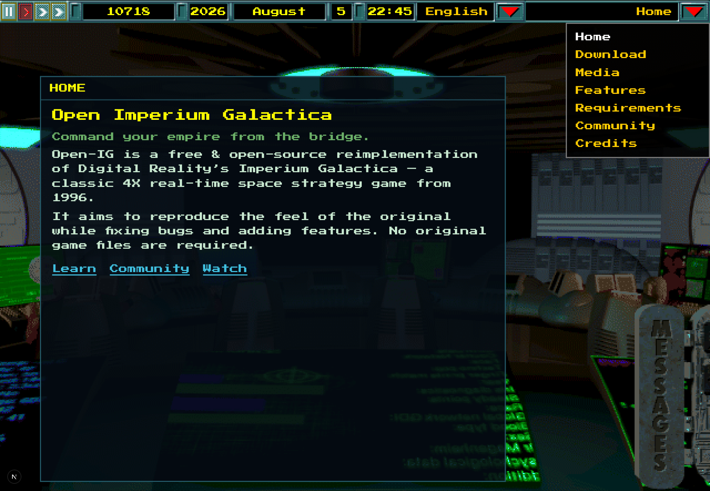
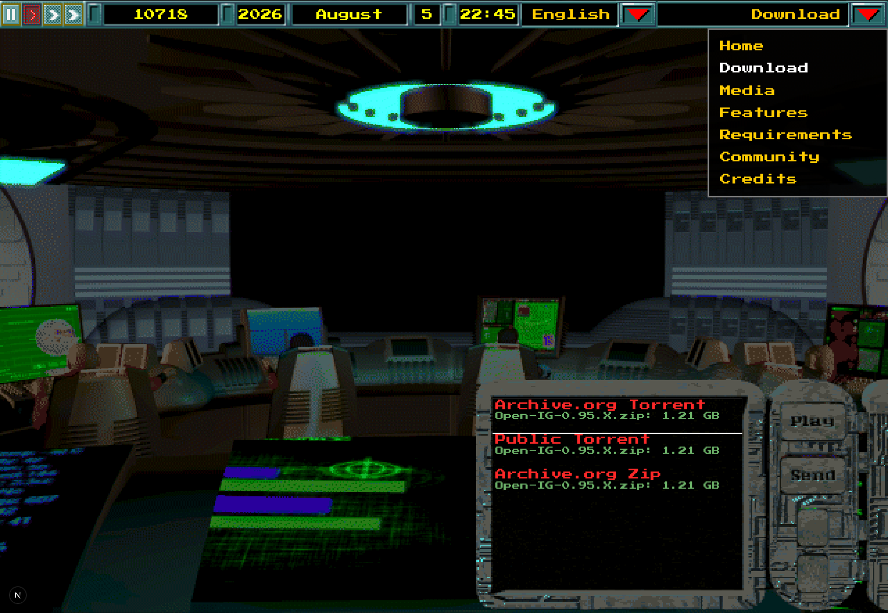

# Open Imperium Galactica — landing site

Marketing site for [Open Imperium Galactica (Open-IG)](https://github.com/akarnokd/open-ig), a free & open-source reimplementation of Digital Reality’s *Imperium Galactica* (1996).

Instead of a conventional landing page, the site is an **interactive recreation of the in-game level-3 bridge**: status bar, viewscreen content panels, screen menu, and the communicator download panel — all real DOM for SEO, scaled to the classic 640×442 stage.

Locales: English, Hungarian, German, French, Spanish, Russian. Copy can be edited in Sanity Studio (`/studio`) or falls back to built-in seed content.

Bridge art, communicator chrome, cursors, status bar, buttons, and related game assets are taken from [akarnokd/open-ig](https://github.com/akarnokd/open-ig).

## Screenshots

### Home



### Download (communicator open)



## Stack

- Next.js App Router + Tailwind CSS v4
- next-intl (locales under `src/i18n/`)
- Sanity CMS (optional; schemas in `src/sanity/`)

See [AGENTS.md](./AGENTS.md) for layout coordinates, assets, and agent notes.

## Quick start

```bash
npm install
cp .env.example .env.local   # optional — Sanity; site works without it
npm run dev
```

Open [http://localhost:3000](http://localhost:3000) (redirects to a locale such as `/en`).

## Deploy (Vercel)

- Root directory: `web`
- Framework: Next.js
- Set env vars from `.env.example` when connecting Sanity

## Sanity

1. Create a free project at [sanity.io/manage](https://www.sanity.io/manage)
2. Set `NEXT_PUBLIC_SANITY_PROJECT_ID` (and dataset)
3. Open `/studio` to edit landing-page copy per locale
